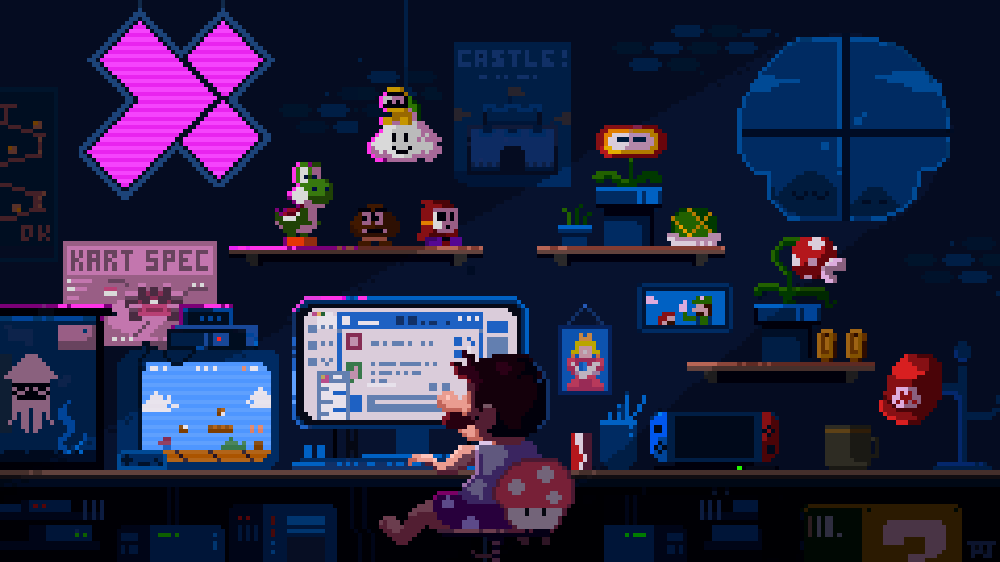
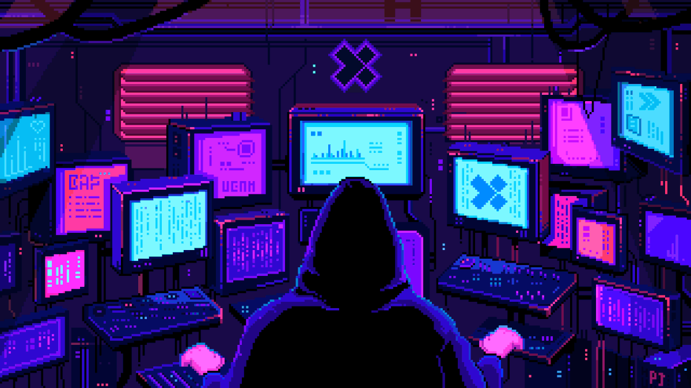
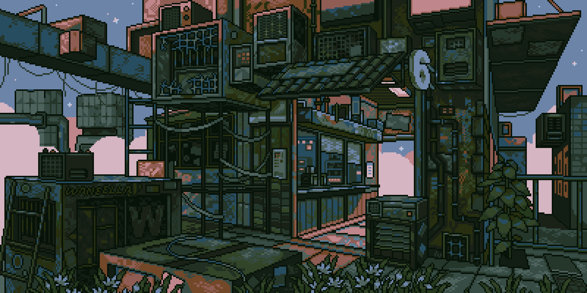
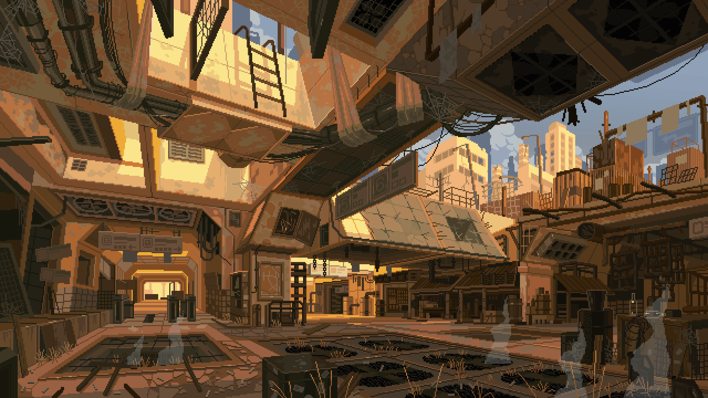
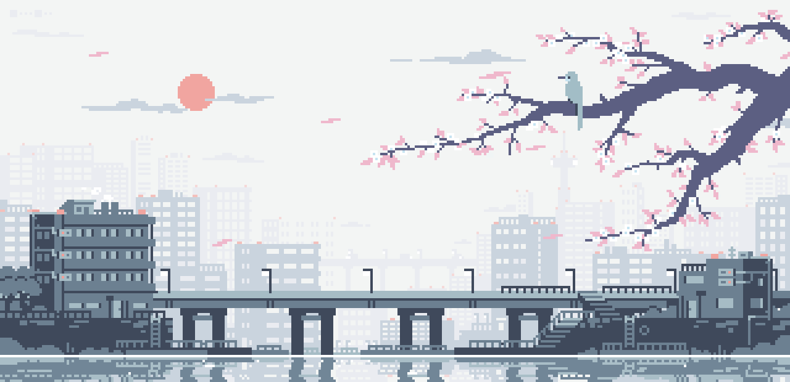
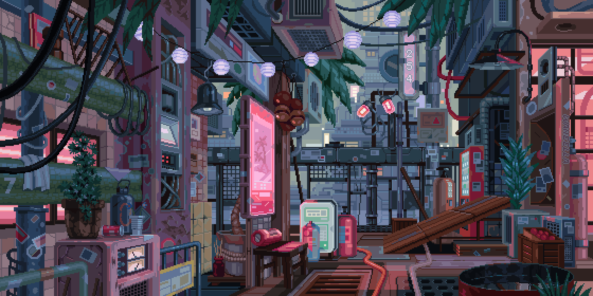
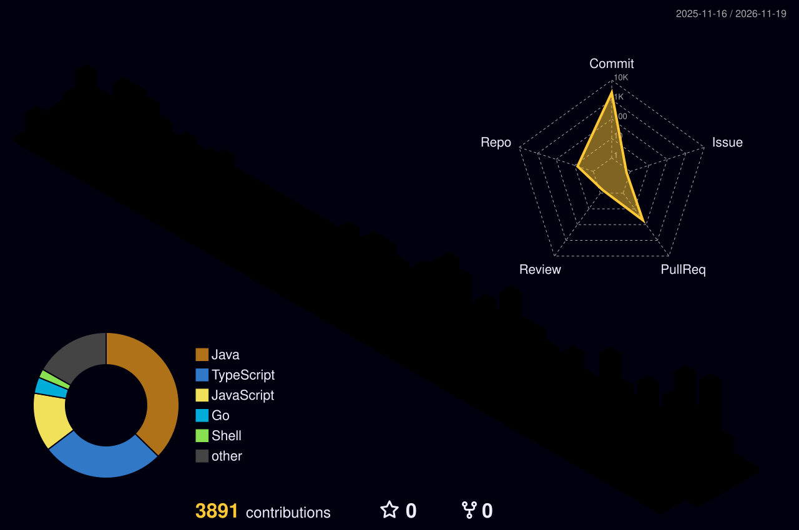

<!-- ==================== PIXEL ART HEADER BANNER ==================== -->

  

<!-- ==================== PLAYER TITLE ==================== -->

  

---

<!-- ==================== SECTION 1: ABOUT & PERSONAL EDGE ==================== -->
|  |  |
| :--- | :--- |
| **Tung Anh (DawnBreaker)** — Web Developer specializing in **Java Backend & Scalable Systems**.  • **Backend Core:** Java & Spring Boot • RESTful APIs • Microservices • **Databases:** PostgreSQL, MySQL • Schema & Query Tuning • **Architecture:** Clean Architecture • High Throughput • Maintainability • **Frontend Stack:** TypeScript, Angular, React   |  |

---

  &nbsp;&nbsp;

<!-- ==================== SEAMLESS CONNECT & RADAR TELEMETRY ==================== -->

  &nbsp;&nbsp;
  &nbsp;&nbsp;
  &nbsp;&nbsp;
  

<!-- ==================== DYNAMIC ENGINEERING QUOTE ==================== -->

  

---

<!-- ==================== SECTION 3: TECH INVENTORY ==================== -->

  
  
  
  
  
  
  
  
  
  
  

---

<!-- ==================== SECTION 4: LIVING ACTIVITY & PULSE ==================== -->
### 👾 Living Activity & Consistency Radar

<!-- Stage 01: Snake Game (Full Width) -->

  <picture>
    <source media="(prefers-color-scheme: dark)" srcset="https://raw.githubusercontent.com/DawnBreaker207/DawnBreaker207/main/dist/grid-snake-dark.svg">
    <source media="(prefers-color-scheme: light)" srcset="https://raw.githubusercontent.com/DawnBreaker207/DawnBreaker207/main/dist/grid-snake.svg">
    
  </picture>

<!-- Stage 02: Pacman Game (Full Width) -->

  <picture>
    <source media="(prefers-color-scheme: dark)" srcset="https://raw.githubusercontent.com/DawnBreaker207/DawnBreaker207/output/pacman-contribution-graph-dark.svg">
    <source media="(prefers-color-scheme: light)" srcset="https://raw.githubusercontent.com/DawnBreaker207/DawnBreaker207/output/pacman-contribution-graph.svg">
    
  </picture>

<!-- Stage 03: Activity Pulse Curve (Full Width) -->

  

<!-- Row 4: Metrics 2 Columns (Streak & Coding Hours) -->
|  |  |
| :--- | :--- |
|  |  |

---

<!-- ==================== SECTION 5: PIXEL ART GALLERY ==================== -->

  

| |  |
| :--- | :--- |
|  |  |

|  |  |
| :--- | :--- |
|  |  |

---

<!-- ==================== SECTION 6: GITHUB TELEMETRY & 3D MATRIX ==================== -->
### 📈 GitHub Telemetry & Analytics

<!-- 3D Contribution Matrix -->

  

| |  |
| :--- | :--- |
|  |  |

|  |  |
| :--- | :--- |
|  |  |

|  |  |
| :--- | :--- |
|  |  |

|  |  |
| :--- | :--- |
| &emsp; | &emsp; |

---

<!-- ==================== SECTION 7: ACHIEVEMENTS & FOOTER ==================== -->

  <h3>🏆 Boss Trophies & Unlocked Achievements</h3>
  

    
  

